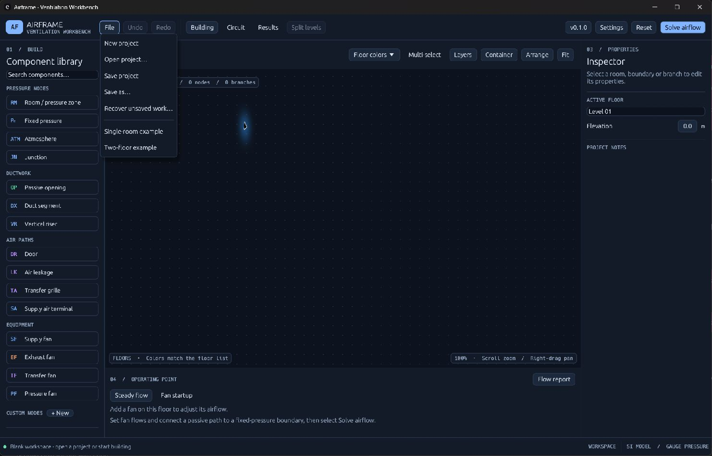
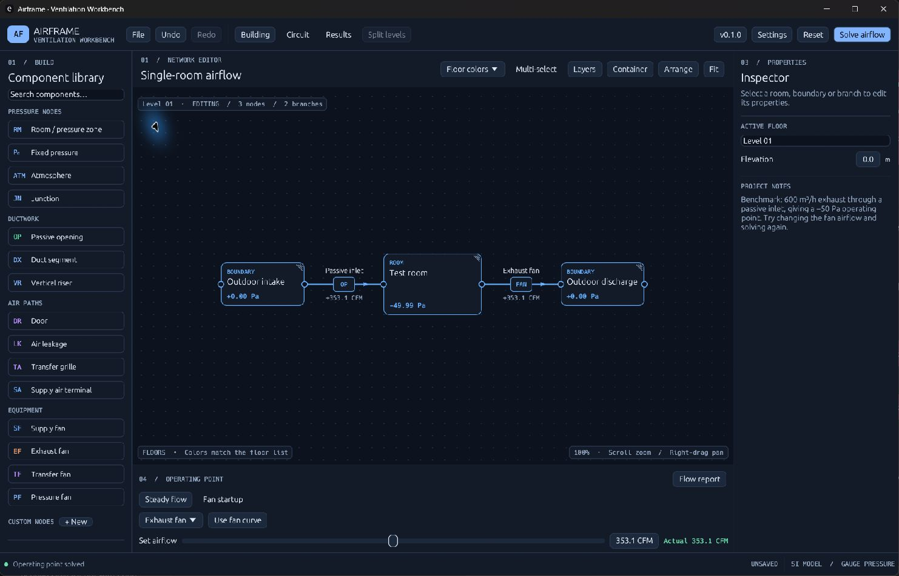

# Airframe quick start

1. Download **Airframe-Setup-x64.exe** from the [latest GitHub release](https://github.com/Hola3Dprint/Airframe/releases/latest) and double-click it. Airframe opens when installation finishes. You can reopen it from the Windows Start menu or desktop.
2. In Airframe, click **File → Single-room example**.

   

3. Click **Solve airflow** at the top right, then **Results** to see room pressures and airflow. Use **Building** to return to the model.

   

Airframe checks for updates automatically. You can also click the version number in the toolbar and choose **Check for updates**.
